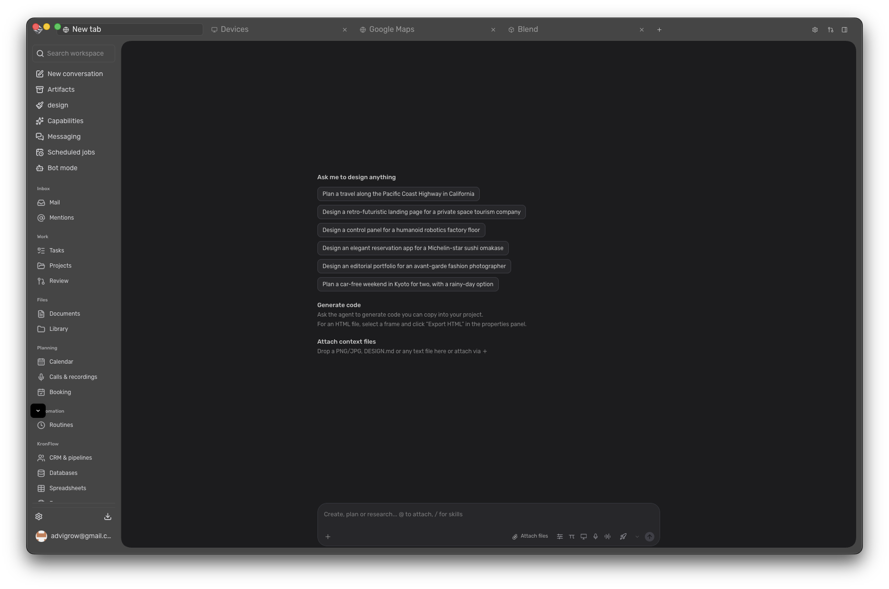
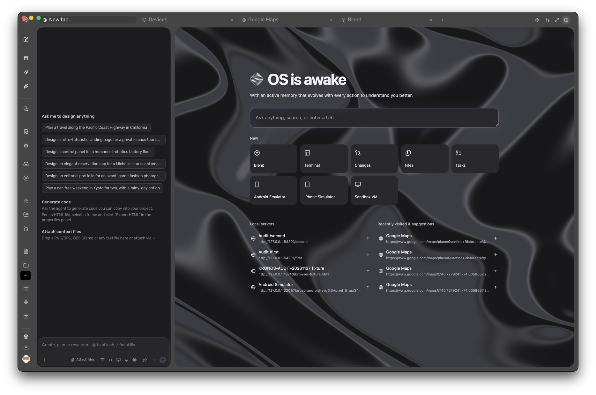
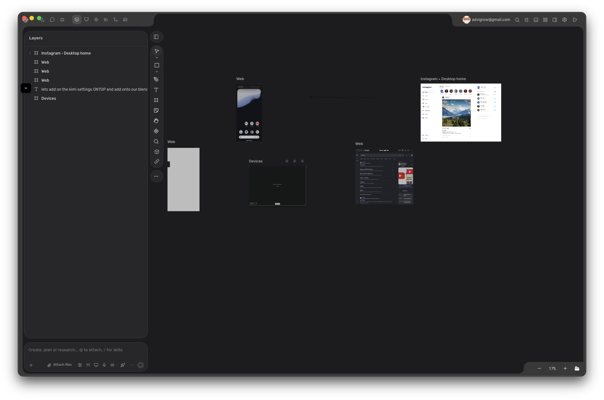
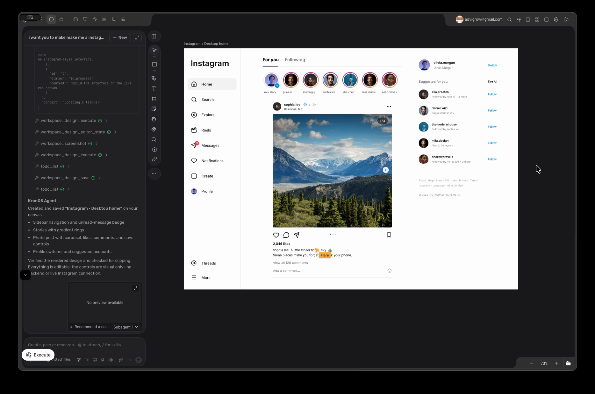
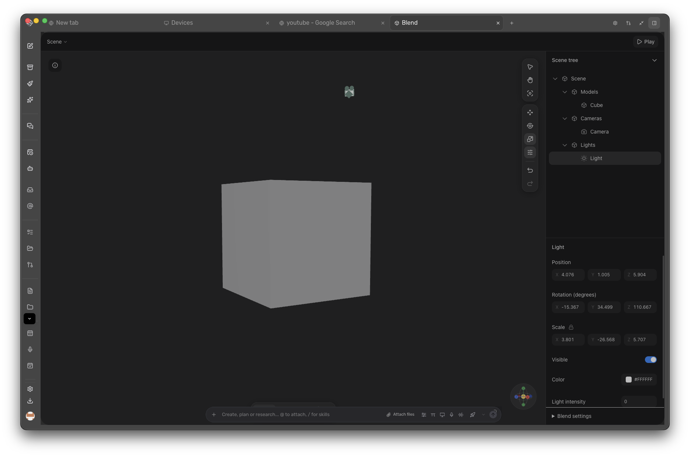
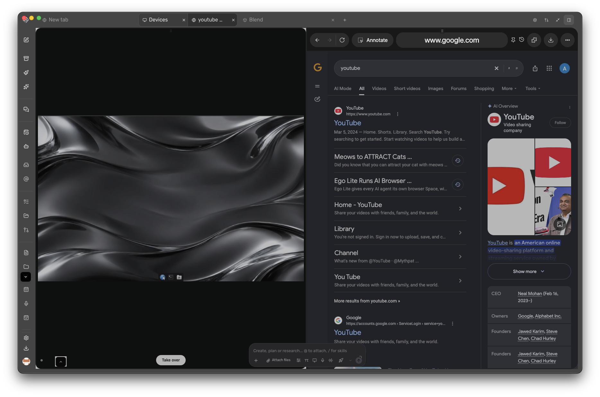
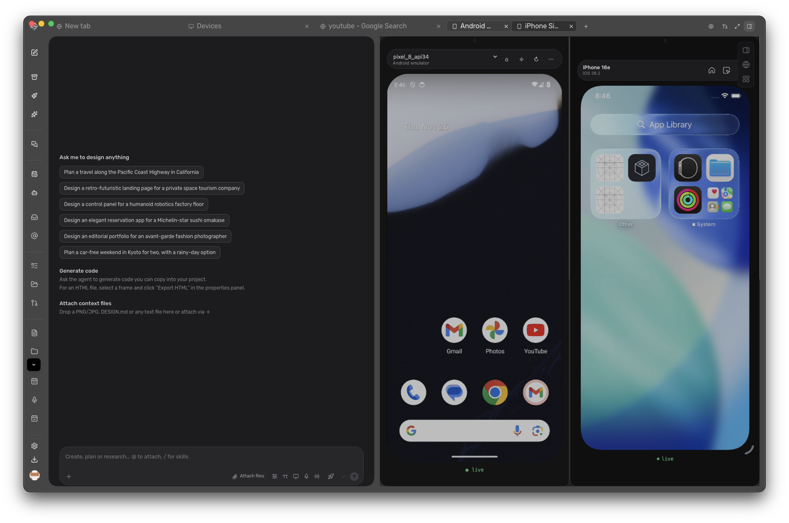

<p align="center">
  <a href="https://ahmedalsadi-1.github.io/kronos-releases/">
    
  </a>
</p>

<h1 align="center">KronOS</h1>

<p align="center">
  <strong>A living workspace for human + agent development.</strong><br>
  Terminal · Browser · Files · Sandboxes · Desktop control · AI
</p>

<p align="center">
  <a href="https://ahmedalsadi-1.github.io/kronos-releases/"></a>
  <a href="https://github.com/Ahmedalsadi-1/kronos-releases/releases"></a>
  <a href="https://ahmedalsadi-1.github.io/kronos-releases/docs/"></a>
  <a href="https://discord.gg/XfvZ334gwU"></a>
</p>

<p align="center">
  <a href="README.ko.md">한국어</a>
</p>

<p align="center">
  
</p>

KronOS is a persistent desktop workspace for your apps, agents, and models. Keep terminals, browser pages,
files, previews, and agent conversations together, then arrange them as tiled widgets, tabs, a spatial canvas,
or a desktop shell.

KronOS Agent is the conversation and control surface, backed by a managed Hermes runtime. It connects workspace
context with terminal, file, browser, and computer tools, while showing tool activity, approvals, and results.

**Status:** private-beta development. macOS is the initial release target; Windows and Linux builds remain under
evaluation. The iPhone client is Labs work. Source integrations described here do not guarantee availability in a
published installer.

[Downloads and release notes](https://github.com/Ahmedalsadi-1/kronos-releases/releases) ·
[Product website](https://ahmedalsadi-1.github.io/kronos-releases/) ·
[User documentation](https://ahmedalsadi-1.github.io/kronos-releases/docs/)

## Work in one place

- **Keep project context visible.** Open terminals, documentation, local web apps, files, and previews beside the agent.
- **Change the presentation.** Use the same blocks across four workspace modes without rebuilding your workspace.
- **Give the agent context.** Attach selected widgets and task cards as focus or evidence; follow actions and results
  through activity overlays and task/evidence graphs.
- **Review development work.** Use workspace worktrees, per-file changes, scheduled automations, and lifecycle scripts.
- **Work locally or over SSH.** Remote terminals, files, and previews share the local workspace model.

### Four workspace modes

| Mode          | How you work                                                                                      |
| ------------- | ------------------------------------------------------------------------------------------------- |
| Tiled widgets | Arrange live blocks in resizable splits and magnify a surface when you need focus.                |
| Tabs          | Use a browser-style widget tab strip with reordering and split panes.                             |
| Canvas        | Move and resize widgets alongside notes, shapes, connectors, and agent task cards.                |
| OS            | Use the KronOS desktop shell with a dock, overview, Cover Flow switcher, and native app surfaces. |

The `app:layoutmode` setting accepts `widgets`, `tabs`, `canvas`, or `os`:

```json
{
  "app:layoutmode": "canvas"
}
```

Command Center (`Cmd+Shift+Space`) provides access to apps, commands, and workspaces. The agent has a separate
command palette (`Cmd+Shift+P`) and `/files`, `/terminal`, and `/preview` commands.

### Agent and workspace tools

KronOS starts and monitors the managed Hermes runtime and exposes connection and recovery state in the app.
The agent can use workspace tools, configured MCP servers, and task-specific skills. Available tools depend on the
active surface, runtime configuration, and granted permissions.

The workspace includes terminal sessions, an embedded Chromium browser, file browsing, Monaco-based editing with
language-server support, and previews for documents and media. Computer and app-stream surfaces require their
configured providers and host permissions. Host, browser, and sandbox actions use distinct routes; tool discovery
does not itself grant permission to execute a tool.

See the [Hermes tool bridge](./agents/hermes/README.md),
[delegation integration](./agents/hermes/plugins/advanced-delegation/README.md), and
[computer provider model](./emain/computer-plugins/README.md) for implementation details.

### Development integrations

These integrations have separate setup requirements and verification limits. Treat them as development capabilities
unless the release notes explicitly include them.

| Integration     | Scope and setup                                                                                                                                                             |
| --------------- | --------------------------------------------------------------------------------------------------------------------------------------------------------------------------- |
| Workflows       | n8n editor, nodes, credentials, and execution connected to workspace tools. Requires its separately prepared runtime; see [n8n setup](./integrations/n8n/README.md).        |
| Designer        | Hosted Pen editor with KronOS document storage and agent routing. Requires separately staged vendor artifacts; see [Pen setup and licensing](./integrations/pen/README.md). |
| Image workflows | ComfyUI editor connected to a local server. Models and Python nodes come from that server; see [ComfyUI setup](./integrations/comfyui/README.md).                           |
| Linux desktops  | Isolated desktop execution and visible computer use. See [KronOS Linux on Apple silicon](./docs/os-mode/kronos-linux.md).                                                   |
| Voice           | Optional Python speech capture, transcription, and speech output. Experimental; see [audio engine](./audio-engine/).                                                        |
| iPhone          | Labs client and paired-host bridge. See [mobile setup and limitations](./mobile/README.md).                                                                                 |

The repository also contains creative studios, productivity surfaces, desktop pets, and device-session integrations.
Registration in source is not evidence that a surface is ready for release. The
[feature reference](./docs/motion-designer/FEATURES.md) records development status and visual examples.

## See the workspace

These screenshots and the recording show the November 2026 development build. Device control and creative integrations
require their configured local runtimes; the iPhone work remains Labs.

### Chat beside your work

Keep the agent conversation beside a browser or workspace start page. Expanded navigation brings conversations,
artifacts, tasks, projects, documents, and planning surfaces into the same frame.



### Live surfaces on the canvas

Arrange browser pages, device views, and editable designs on a shared canvas. The layer tree provides another way to
find and select content while the agent composer stays within reach.



### From a conversation to an editable design

The recording shows an agent-created social interface mockup in the Designer, with tool activity and the resulting
editable canvas in view. The sample is a visual design, with no live social-network connection.

[](./assets/readme/agent-design-demo.mp4)

[Watch the 34-second design walkthrough](./assets/readme/agent-design-demo.mp4).

### Inspect a 3D scene

The Blend surface places a scene viewport, object hierarchy, and transform and lighting controls inside the workspace.
This capture shows a simple cube scene in the development integration.



### Keep a computer and browser together

View a configured Linux desktop beside an embedded browser. The visible **Take over** control provides a handoff point
for the computer session.



### Inspect mobile devices beside the agent

Android emulator and iPhone Simulator views can sit beside the conversation. These are developer device-control
surfaces; the screenshot does not establish availability of a released mobile client.



## Develop from source

This is the KronOS application source repository. Public downloads are maintained separately in
[kronos-releases](https://github.com/Ahmedalsadi-1/kronos-releases/releases).

Start with **Node.js 22**, **Go 1.25.6 or newer**, **Task**, and the platform build tools required by Electron's native
dependencies. The optional n8n integration requires **Node.js 24 or newer** and has its own preparation process.
Building the native agent harness also requires Rust/Cargo. Consult each integration guide before enabling it.

```bash
git clone https://github.com/Ahmedalsadi-1/kronos-v2.git
cd kronos-v2
task init
task dev
```

`task init` installs the root and documentation Node dependencies and resolves Go modules. It does not provision
every optional runtime, model, or vendor editor. In particular, the application build checks for a staged Pen runtime;
follow the [Pen staging instructions](./integrations/pen/README.md) if that check fails.

The [build guide](./BUILD.md) contains platform prerequisites and debugging information. It still includes upstream
Wave clone examples; use the KronOS clone command above for this repository. Main-process and preload changes require
stopping and restarting Electron; renderer changes generally use Vite hot updates.

| Command                               | Purpose                                                                                      |
| ------------------------------------- | -------------------------------------------------------------------------------------------- |
| `task dev`                            | Run the full development stack with renderer hot updates.                                    |
| `task electron:quickdev`              | Run the reduced macOS arm64 development path, skipping binding generation and the wsh build. |
| `task preview`                        | Run the standalone component preview without Electron or backend services.                   |
| `task start`                          | Run Electron against existing frontend build output with backend dependencies.               |
| `task package`                        | Build and package the application into `make/`; requires staged release runtimes.            |
| `task check:ts`                       | Typecheck the frontend and Electron code.                                                    |
| `npm test -- --run`                   | Run the frontend Vitest suite once.                                                          |
| `go test ./pkg/...`                   | Run Go package tests.                                                                        |
| `npm --prefix mcp-kron-term run test` | Build and test the MCP bridge.                                                               |
| `npm --prefix website run build`      | Build the product website.                                                                   |
| `npm --prefix docs run build`         | Build the documentation site.                                                                |

Follow [AGENTS.md](./AGENTS.md) and the nearest directory instructions when changing code. Do not edit generated RPC
bindings or `frontend/types/gotypes.d.ts`; update the Go definitions and run `task generate`. Do not run `go build`
inside individual subpackages.

## Repository map

The desktop uses Electron, React 19, TypeScript, Jotai, and Go services. Hermes runs behind the managed agent bridge;
`mcp-kron-term` exposes workspace and computer tools to external MCP clients.

| Path                            | Responsibility                                                 |
| ------------------------------- | -------------------------------------------------------------- |
| `frontend/app/`                 | Workspace layouts, blocks, views, state, and the KronOS shell. |
| `frontend/hermes/`              | Embedded Hermes conversation and settings UI.                  |
| `emain/`                        | Electron lifecycle, IPC, native bridges, and managed runtimes. |
| `pkg/`, `cmd/`                  | Go services, PTYs, SSH, persistence, RPC, and the wsh CLI.     |
| `agents/hermes/`                | Hermes plugins, tool adapters, delegation, and native harness. |
| `mcp-kron-term/`                | Workspace and computer-use MCP server.                         |
| `integrations/`                 | Editor and runtime adapters with separate setup and licensing. |
| `audio-engine/`, `desktop-pet/` | Optional speech pipeline and companion window content.         |
| `mobile/`                       | iPhone Labs client and phone-control bridge.                   |
| `website/`, `docs/`             | Product website and Docusaurus documentation.                  |
| `video/`                        | Product demos and video production projects.                   |

KronOS builds on Wave Terminal 0.14.3. The Go module `github.com/wavetermdev/waveterm`, `waveai:*`, `.waveterm`,
and other Wave identifiers remain where compatibility requires them. KronosCode is retired; remaining package paths
are legacy compatibility code. Embedded sibling repositories such as `kronoscoder/`, `third_party/`, and
`UI-TARS-desktop/` are separate projects.

## Documentation and support

- [User documentation](https://ahmedalsadi-1.github.io/kronos-releases/docs/)
- [Build and debugging guide](./BUILD.md)
- [Repository instructions](./AGENTS.md)
- [MCP bridge](./mcp-kron-term/README.md)
- [Roadmap](./ROADMAP.md)
- [Video production guide](./video/README.md)
- [Motion designer guide](./docs/motion-designer/START-HERE.md), [assets](./docs/motion-designer/ASSETS.md), and
  [media inventory](./docs/motion-designer/assets.csv) (includes historical branch handoff instructions)
- [Discord](https://discord.gg/XfvZ334gwU)

## License and attribution

The host repository includes the [Apache License 2.0](./LICENSE). See [NOTICE](./NOTICE),
[ACKNOWLEDGEMENTS.md](./ACKNOWLEDGEMENTS.md), and [third-party notices](./THIRD_PARTY_NOTICES.md).
Integrated runtimes, vendor artifacts, and nested projects retain their own licenses; the host license does not
relicense them.
