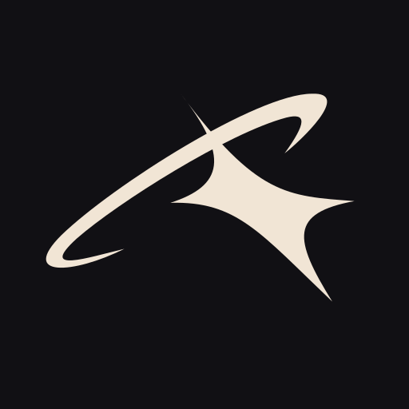

<p align="center">
  <a href="https://ahmedalsadi-1.github.io/kronos-releases/">
    
  </a>
</p>

<h1 align="center">KronOS</h1>

<p align="center">
  <strong>A living workspace for human + agent development.</strong><br>
  Terminal · Browser · Files · Sandboxes · Desktop control · AI
</p>

<p align="center">
  <a href="https://ahmedalsadi-1.github.io/kronos-releases/"></a>
  <a href="https://github.com/Ahmedalsadi-1/kronos-releases/releases"></a>
  <a href="https://ahmedalsadi-1.github.io/kronos-releases/docs/"></a>
  <a href="https://discord.gg/XfvZ334gwU"></a>
</p>

<p align="center">
  <a href="README.ko.md">한국어</a>
</p>

<p align="center">
  
</p>

Keep your terminal, browser, files, and AI in one persistent workspace. KronOS puts the tools you use to build and
check your work beside each other, so you can follow a task without repeatedly rebuilding its context in separate apps.

KronOS Agent provides the chat and control surface, backed by the managed Hermes runtime, with tool activity,
approvals, and results available for review as you work.

**macOS is the initial release target.** Windows and Linux builds remain under evaluation; the iPhone client is Labs work.

**[Downloads and release notes](https://github.com/Ahmedalsadi-1/kronos-releases/releases)** · [Build from source](./BUILD.md)

The application source stays private. Public installers and user-submitted support issues live in a separate
downloads repository. Connect your own provider key or a compatible local model; no KronOS account is required.
Diagnostics remain local until a user previews and shares a support report from Settings > About.

### See the work together

- **Choose your layout.** Switch between tiled widgets, focused tabs, a spatial canvas, and the KronOS desktop shell.
- **Give the agent context.** Use selected widgets and task cards as focus or evidence instead of copying everything into chat.
- **Review, don't guess.** Stage or discard agent edits per file, spin up a parallel worktree for each agent, and schedule the prompts that should run on their own.
- **Keep actions inspectable.** Follow commands, edits, approvals, and browser evidence alongside your project.

### Motion designer handoff

**Working branch: [`feat/kronsettings-from-kronoschamber`](https://github.com/Ahmedalsadi-1/kronterm/tree/feat/kronsettings-from-kronoschamber).**
Start with the [designer guide](./docs/motion-designer/START-HERE.md) for the product story, branch instructions,
footage review workflow and delivery checklist. The [feature reference](./docs/motion-designer/FEATURES.md) covers
capabilities and development status; the [asset index](./docs/motion-designer/ASSETS.md) and
[searchable media inventory](./docs/motion-designer/assets.csv) locate recordings, screenshots, brand resources,
illustrations, audio and existing video projects. [Download this branch as a ZIP](https://github.com/Ahmedalsadi-1/kronterm/archive/refs/heads/feat/kronsettings-from-kronoschamber.zip).
Keep the archive folders together so project links resolve. Separate nested repositories are represented by revision
pins and change backups; see the guide before trying to rebuild them.

### Product videos

The repository includes product demos built from screen recordings and animated compositions. See the
[video production guide](./video/README.md) for scene breakdowns and local render commands. These demos show development
builds; feature availability follows the status notes below.

## What is new

The current development line expands KronOS from a tiled terminal workspace into a complete human-and-agent desktop.

| Ability                           | What changed                                                                                                                                                                             | Status                         |
| --------------------------------- | ---------------------------------------------------------------------------------------------------------------------------------------------------------------------------------------- | ------------------------------ |
| **Three workspace modes + OS**    | Tiled splits, browser-style widget tabs, freeform spatial canvas, and the new KronOS desktop shell (see below).                                                                     | Private-beta development build |
| **Agent-aware canvas**            | Place live widgets, notes, shapes, connectors, and agent task cards on one zoomable surface.                                                                                             | Private-beta development build |
| **Context from the canvas**       | Send a widget or agent card to KronOS Agent as the active focus or as quoted evidence.                                                                                                     | Private-beta development build |
| **Visible task graph**            | Follow requests, decisions, actions, approvals, evidence, and outputs through connected cards.                                                                                           | Private-beta development build |
| **Resilient KronOS Agent**      | The local agent runtime reports startup and health state, reconnects, and exposes recovery guidance.                                                                                     | Private-beta development build |
| **KronOS (Spatial Mode)**    | Calm window composition, flat grid overview, connected shell dock, Cover Flow app switcher, and typed `os.*` surface actions for agent control.                                          | Private-beta development build |
| **Control Center workflow tools** | Worktrees, changes review, scheduled automations, and lifecycle scripts for the workspace, all inside the OS Control Center (see below).                                                 | Private-beta development build |
| **KronOS Agent surface**        | Embedded agent panel with file/terminal/preview slash commands, agent-working badges, activity anchored to the OS HUD, and grouped browser file view with drag-to-canvas.                | Private-beta development build |
| **Global command palette**        | `Cmd+Shift+P` opens the agent command palette (including workspace mode switches) instead of a separate modal.                                                                           | Private-beta development build |
| **App Stream & native apps**      | Live app-stream rails, native app launches via shared `AppIcon` registry, and real app icons in the shell.                                                                               | Private-beta development build |
| **Command Center**                | Grouped palette at `Cmd+Shift+Space` for apps, commands, and workspaces.                                                                                                                 | Private-beta development build |
| **Tabs and browser polish**       | Orca-style fixed-width tab strip with active indicator, hover close, and drag reordering; browser toolbar loading bar, Escape-to-restore omnibox edits, and press feedback.              | Private-beta development build |
| **Plugin platform (Milestone A)** | Manifest v1 schema, capability model, and consent canonicalization for plugin contributions — widgets, apps, commands, settings, skills, agent tools, ACP agents, MCP servers, and more. | In development                 |
| **Code intelligence**             | Monaco-based editing now connects to local language servers for richer code navigation and diagnostics.                                                                                  | Private-beta development build |
| **Minimal UI**                    | A quiet-chrome appearance mode (`app:minimalui`) that trims chrome and lets the work take the foreground.                                                                                | Private-beta development build |
| **Desktop pet & overlays**        | A companion desktop pet window and live agent activity overlays that surface what agents are doing without stealing focus.                                                               | Private-beta development build |
| **Voice interaction**             | A microphone control connects local audio capture and transcription to chat, with speech output support.                                                                                 | Experimental                   |
| **KronOS for iPhone**           | A native shell can open surfaces on a compatible Labs host or an explicitly paired computer.                                                                                           | Labs                           |

Experimental, Labs, and In development features may require additional local dependencies and can change before release.

## Computer, delegation, and workflow development

This branch also contains newer integrations beyond the established workspace surfaces:

- **Computers:** managed desktop providers, per-widget live viewers and fullscreen, workspace-scoped control grants,
  and device batch/runtime support. See the [computer viewer guide](./frontend/hermes/computer/upstream/README.md)
  and [provider/access model](./emain/computer-plugins/README.md). These require configured providers and local setup.
- **Delegation:** subagent presentation and settings for default, model-route and profile-route delegation, backed by
  configured Hermes runtimes. See the [delegation plugin](./agents/hermes/plugins/advanced-delegation/README.md).
- **Workflows, in development:** original n8n components share the OS world with workspace content; scoped runtime,
  tool/widget nodes, node inspection and execution views connect workflows to the agent workspace. See the
  [integration setup](./integrations/n8n/README.md) and [implementation and remaining interaction gates](./docs/os-mode/workflow-canvas-plan.md).
  Source and fixture checks do not establish complete rendered interaction acceptance.

The source also registers Video, Audio, Document, Data, Image and Game Studio surfaces, Blender projects, a Media
Library, personal productivity and Tapflow device sessions. These need separate runtime/capture verification before
being presented as release-ready features; see the designer guide for the full registered surface inventory.

The designer [feature reference](./docs/motion-designer/FEATURES.md) maps these capabilities to source and visual
examples. Describe them as development integrations rather than generally available release features.

## One workspace, multiple ways to work

KronOS keeps the same widgets and project context while changing how they are presented.

### Tiled widgets

Arrange terminal, browser, preview, editor, AI, system, and sandbox blocks in resizable splits. Drag blocks to reflow the
layout, magnify one surface, or return to the saved composition.

### Focused tabs

Keep one widget visible at a time in a browser-style tab strip. Fixed-width tabs show an active indicator and a hover
close control, reorder by drag, and scroll with a chevron when they overflow. Drag tabs between split panes and create a
split above, right, below, or left without rebuilding the workspace.

### Spatial canvas

Move and resize live widgets on an infinite canvas. Pan, zoom, fit the workspace, add notes and diagram primitives, and
connect related work. Agent execution appears on the same surface as a live graph, so a request can stay attached to its
actions, approvals, evidence, and result.

### KronOS (Spatial Mode)

A calm desktop shell — flat grid overview, connected shell dock, Cover Flow app switcher, native app launches, and drag-to-canvas from the grouped file browser. Motion uses no-overshoot springs with quiet menu entrances. Agents can drive it through typed `os.*` surface actions (`frontend/app/workspace/kronarchy-shell.tsx`).

Set the presentation through KronSettings or with the `app:layoutmode` configuration key:

```json
{
  "app:layoutmode": "canvas"
}
```

Valid values are `widgets`, `tabs`, `canvas`, and `os` (KronOS).

For a quieter, lower-chrome look, enable Minimal UI with the `app:minimalui` configuration key (also in KronSettings →
Visual). It keeps every capability available while trimming visual noise.

```json
{
  "app:minimalui": true
}
```

### Control Center and Activity Center

The OS strip keeps two system panels within reach of the desktop shell.

**Control Center** manages the host and the workspace: SSH **connections**, host **permissions** (screen recording,
accessibility, microphone) with grant state, **plugin capability grants** you can revoke, space restoration after a
restart, and the workflow tools:

- **Worktrees** — list, create, and remove parallel git worktrees for the project root. Each new worktree gets its own
  `kronterm/<name>` branch, so separate agents can work side by side instead of fighting over one checkout.
- **Changes** — uncommitted changes with per-file status, `+/-` counts, and a unified diff on click. **Accept** stages a
  file, **Discard** reverts it, the right-click menu copies the diff, and a change row can be dragged straight into the
  agent prompt as a file reference.
- **Automations** — saved agent prompts on `@15m`, `@hourly`, `@daily`, or `@weekly` schedules with run-now,
  pause/resume, and delete. Each run is recorded in the activity timeline with its prompt.
- **Lifecycle scripts** — persist `setup`, `teardown`, and `run` commands per workspace and execute them with `sh` from
  the project root; exit code and output come back in the panel.

**Activity Center** carries jobs, approvals, and recovery state — what the agent is doing, what it is waiting for, and
what needs attention.

## KronOS Agent

KronOS Agent uses a managed Hermes runtime. It combines the request with current workspace context, chooses the
correct operating surface, runs tools within that boundary, and returns the result with the evidence still visible.

<p align="center">
  
</p>

### What the agent can work with

| Surface                 | Available context and actions                                                                                                                                     |
| ----------------------- | ----------------------------------------------------------------------------------------------------------------------------------------------------------------- |
| **Terminal**            | Read scrollback and shell state, run commands, monitor processes, and preserve exit evidence (connected shell dock in OS mode).                                   |
| **Files and code**      | Browse local or remote files, edit with diff review, use LSP-backed code intelligence, and drive the grouped file browser with drag-to-canvas.                    |
| **Browser**             | Inspect structured page state, navigate, click, type, scroll, capture screenshots, and validate flows.                                                            |
| **Sandbox**             | Create and operate isolated Linux desktops with their own browser, editor, terminal, and filesystem.                                                              |
| **macOS desktop**       | Inspect accessibility state and perform visible, permission-aware clicks, typing, key presses, scrolling, and dragging.                                           |
| **Canvas + OS desktop** | Read selected widgets and task cards, follow task lineage, use chosen nodes as focus/quoted evidence, and drive the KronOS desktop via typed `os.*` actions. |
| **App Stream**          | Operate live native or remote app surfaces on dedicated rails (AppIcon registry, interaction state).                                                              |
| **Research and tools**  | Search documentation and the web, call MCP servers, and load task-specific skills.                                                                                |

KronOS Agent streams meaningful tool activity into the UI. Commands, edits, approvals, browser evidence, and recovery state
remain inspectable while the agent works.

### Managed local runtime

KronOS Agent is the primary conversation and control surface. KronOS starts and monitors the local
runtime, refreshes its short-lived connection credentials, reconnects the embedded client, and shows repair information
when the runtime cannot become healthy.

### Voice, experimental

The voice control can start the optional Python audio engine, capture speech, transcribe it with `faster-whisper`, and
submit the transcript to KronOS Agent. Speech output uses an online TTS provider when configured and an offline system
fallback when available. Voice remains opt-in and can be shut down from KronSettings.

## Built-in surfaces

| Surface                       | Purpose                                                                                                                                                      |
| ----------------------------- | ------------------------------------------------------------------------------------------------------------------------------------------------------------ |
| **Terminal**                  | Full PTY sessions, connected shell dock, shell integration, command history, and AI-readable scrollback.                                                     |
| **Browser**                   | Embedded Chromium for documentation, dashboards, localhost, and agent-driven validation, with a toolbar loading bar and Escape-to-restore omnibox edits.     |
| **Preview and editor**        | Markdown, images, media, PDF, CSV, directories, Monaco-based editing, and grouped file browser with drag-to-canvas.                                          |
| **KronOS Agent**            | Workspace-aware chat, tools, approvals, sessions, artifacts, and model controls.                                                                             |
| **KronOS Agent panel**      | Embedded agent surface with command center, file/terminal/preview slash commands, and agent-working badges.                                                  |
| **Kron Sandbox**              | Isolated Linux desktop execution with visible computer use (SandboxDesktopPane).                                                                             |
| **App stream**                | Live native or remote application surfaces on dedicated rails with interaction state and cursor feedback.                                                    |
| **KronOS shell**         | Desktop shell — dock, flat grid overview / Cover Flow switcher, native app launches, and `os.*` agent actions.                                               |
| **Control / Activity Center** | Host permissions, connections, plugin grants, worktrees, changes, automations, lifecycle scripts, and space restoration; plus jobs, approvals, and recovery. |
| **Command Center**            | Grouped palette (`Cmd+Shift+Space`) for apps, commands, and workspaces, plus the global command palette (`Cmd+Shift+P`) in the agent surface.                |
| **Desktop pet & overlay**     | Companion pet window (`desktop-pet/`) and overlay surfaces for ambient agent activity.                                                                       |
| **Launcher and settings**     | Workspace navigation plus visual controls for models, agents, skills, themes, voice, minimal UI, and keybindings.                                            |
| **System information**        | CPU, memory, disk, and network monitoring inside the workspace.                                                                                              |

## Durable remote work

KronOS's SSH sessions survive network changes, sleep, and application restarts. Remote terminals, files, directories,
and previews use the same workspace model as local work, so an agent can reason from the remote evidence you see.

## Extend it

- **MCP bridge.** `mcp-kron-term/` exposes the workspace and computer-use surfaces over MCP, so external agents and
  editors can drive the same blocks, snapshots, and clicks you see in the app.
- **wsh CLI and Widget Protocol.** The `wsh` command line and the Widget Protocol let scripts and agents create blocks,
  control surfaces, and read workspace state (`wsh workspace-surface`, `wsh widget`, and friends).
- **Skills and MCP servers.** KronOS Agent loads task-specific skills and connects to MCP servers for extra tools.
- **Agent packages.** `agents/kronoscode/` and `agents/hermes/` are bundled agent boundaries with their own toolsets.
- **Plugin platform (in development).** A v1 manifest declares what a plugin contributes — widgets, applications,
  commands, typed settings, skills, agent tools, ACP agents, MCP servers, artifact renderers, worktree and source-control
  providers, and attention sources — along with the capabilities it needs. Validation enforces declared capabilities,
  allowlisted executables, and secret-free settings, and consent is canonicalized before a grant is recorded. The model
  is adapted from Orca's MIT plugin manifest (see `THIRD_PARTY_NOTICES.md`); the spec lives at
  `.claude/docs/ai/kronterm/plugin-platform-milestone-a.md`.

## Architecture

```text
KronOS desktop (Electron + React)
├── workspace presentations: widgets · tabs · canvas · os (KronOS shell)
│   ├── Kronarchy shell (kronarchy-shell.tsx) — dock, overview, Cover Flow, os.* actions
│   ├── command center (Cmd+Shift+Space) — grouped apps/commands/workspaces
│   └── system centers — control center (permissions, connections, grants, worktrees,
│       changes, automations, lifecycle scripts) · activity center (jobs, approvals)
├── interactive surfaces: terminal (connected dock) · browser · files (grouped + drag-to-canvas) · sandbox · app stream rails · native apps
├── KronOS Agent: chat · sessions · approvals · artifacts · embedded agent panel (Cmd+Shift+P palette)
├── plugin manifest v1 (frontend/app/plugins/manifest) — capabilities, validation, consent
├── agent activity: live overlays · task/evidence graphs · desktop pet · overlay windows
└── native bridges: audio · accessibility · secure storage · IPC · app icons (AppIcon)

Go services
├── PTY and durable SSH (survives sleep / network changes)
├── wsh RPC and Widget Protocol
├── workspace services: worktrees and diffs · automation scheduler · lifecycle scripts
├── configuration, secrets, events, and persistence
└── preview, file, and sandbox services

KronOS Agent runtime
├── routed agent execution and specialist tools (typed os.* surface for desktop control)
├── MCP servers and loadable skills
├── browser, terminal, desktop, sandbox, and canvas context
└── local session and tool state

mcp-kron-term (MCP bridge)
├── workspace tools: blocks, snapshots, clicks, typing, layout
└── computer-use tools: native app observation and control
```

The repository also contains:

- `mcp-kron-term/` for the workspace and computer-use MCP bridge (see [Extend it](#extend-it)).
- `audio-engine/` for the optional speech pipeline.
- `desktop-pet/` for the standalone desktop pet window content.
- `mobile/` for the KronOS for iPhone Labs client.
- `website/` for the product site (`npm --prefix website run build` to validate).
- `docs/` for the Docusaurus documentation site (`npm --prefix docs run build`).
- `video/` for the Remotion promo composition (`KronTermPromo` 62s cinematic, see `video/AGENTS.md`).
- `agents/kronoscode/` and `agents/hermes/` for the bundled agent package boundaries.

## Security boundaries

Agent actions stay attached to an explicit surface.

| Boundary                | Behavior                                                                                                                                                                                        |
| ----------------------- | ----------------------------------------------------------------------------------------------------------------------------------------------------------------------------------------------- |
| **Host vs. sandbox**    | Host commands and isolated VM actions use separate routes.                                                                                                                                      |
| **Browser vs. desktop** | Structured browser interaction and native accessibility control are distinct capabilities.                                                                                                      |
| **Webview attachment**  | The Electron main process vets every `<webview>` attach: unapproved preloads are stripped and non-conforming guests are denied.                                                                 |
| **Approvals**           | Sensitive file, command, and computer-use actions can pause for confirmation.                                                                                                                   |
| **Plugin capabilities** | Plugins declare capabilities in a v1 manifest; contributions are limited to those capabilities, allowlisted executables, and secret-free settings, with consent recorded before a grant exists. |
| **Secrets**             | Credentials use the operating system's secure store where supported.                                                                                                                            |
| **Model choice**        | Connect OpenAI, Anthropic, Google, OpenAI-compatible services, Ollama, or LM Studio with your own configuration.                                                                                |
| **Local runtime**       | Tool orchestration and workspace state remain local; model requests go to the provider you select.                                                                                              |
| **Visible evidence**    | Tool calls, diffs, screenshots, terminal output, and task state remain available for review.                                                                                                    |

Cloud model providers and managed sandbox providers receive only the data required for the capability you choose. Local
models can keep model inference on the machine.

## KronOS for iPhone, Labs

The iPhone client opens Browser, Workspace, Files, Code, Terminal, and Preview when the paired host exposes them. Chat
requires a Labs host with the legacy KronosCode session API. Connecting chat to the desktop's managed Hermes runtime is
still pending. An optional developer bridge supports approval-gated phone control for testing.

See [`mobile/README.md`](./mobile/README.md) for the implemented slice, setup, and phase boundaries.

## Get KronOS

The public preview is available for Apple silicon Macs running macOS 26 or later.

**[Download the macOS preview](https://ahmedalsadi-1.github.io/kronos-releases/download/)**

| Platform                      | Current status   |
| ----------------------------- | ---------------- |
| macOS (Apple silicon)         | Public preview   |
| Windows (x64)                 | Under evaluation |
| Linux (arm64 and x64)         | Under evaluation |
| iPhone                        | Labs client      |

To build the desktop application from source, follow [`BUILD.md`](./BUILD.md). Common development commands include:

```bash
task init
task dev
task check:ts
npm test -- --run
```

Do not run `go build` inside individual subpackages; use the repository tasks and targeted tests described in
[`AGENTS.md`](./AGENTS.md).

## Documentation

- [Product website](https://ahmedalsadi-1.github.io/kronos-releases/)
- [Hosted documentation](https://ahmedalsadi-1.github.io/kronos-releases/docs/)
- [Build from source](./BUILD.md)
- [Launch KronOS Linux on an Apple Silicon Mac](./docs/os-mode/kronos-linux.md)
- [Contributing](./CONTRIBUTING.md)
- [Roadmap](./ROADMAP.md)
- [KronOS for iPhone](./mobile/README.md)
- [Legacy KronosCode compatibility package](./agents/kronoscode/README.md)

## License and community

KronOS is licensed under [Apache License 2.0](./LICENSE). See [`NOTICE`](./NOTICE) and
[`ACKNOWLEDGEMENTS.md`](./ACKNOWLEDGEMENTS.md) for attribution and dependency information.

- [Discord](https://discord.gg/XfvZ334gwU)
- [X / @krontermdev](https://x.com/krontermdev)
- [GitHub issues](https://github.com/Ahmedalsadi-1/kronterm/issues)

<p align="center">
  <strong>KronOS — keep the whole builder loop in view.</strong>
</p>
