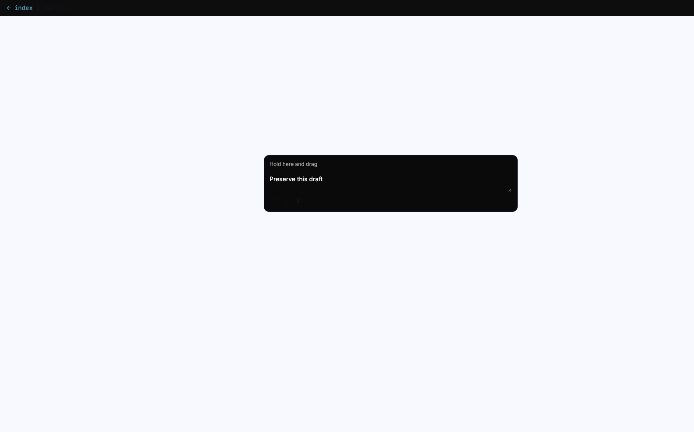
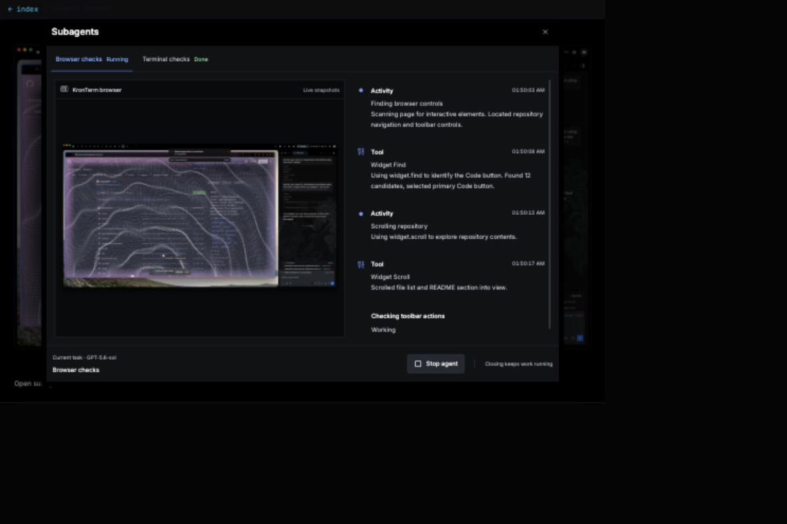
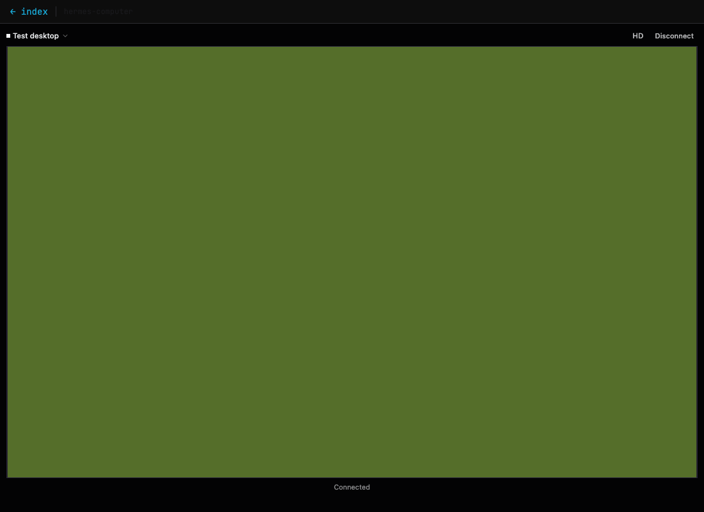
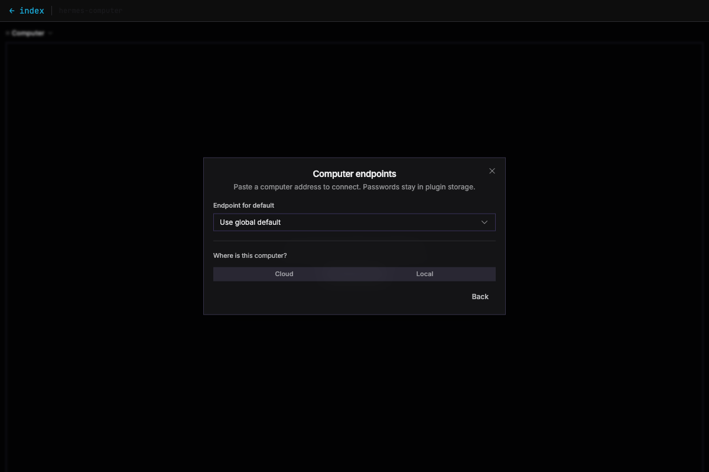
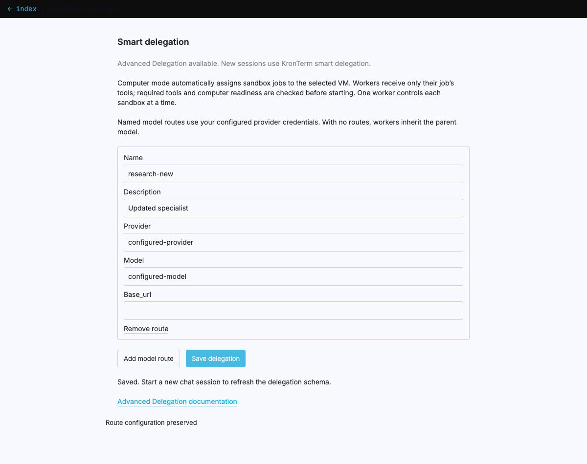
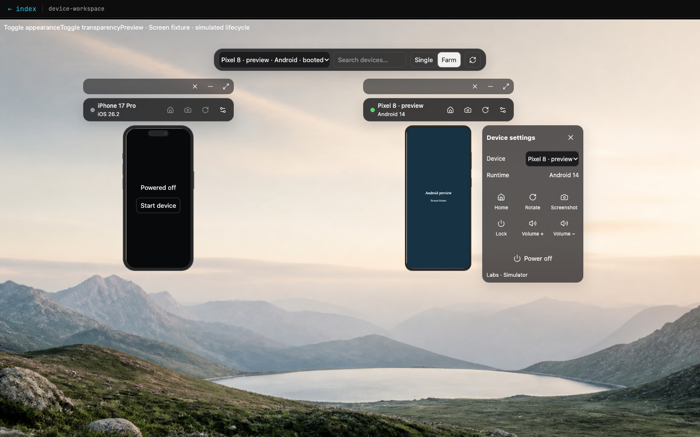
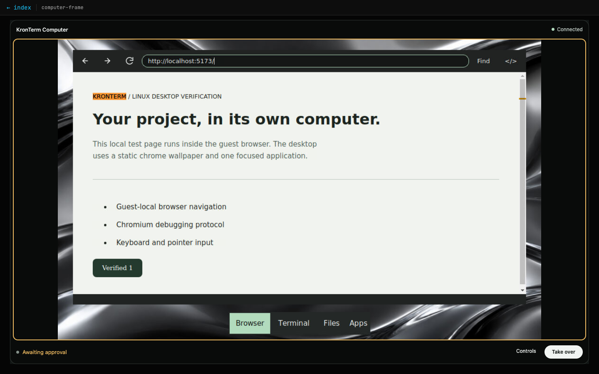

# Visual orientation

Development captures and product reference imagery. These are navigation aids, not release acceptance evidence. Read [FEATURES.md](FEATURES.md) for status and [ASSETS.md](ASSETS.md) for the full library.

## OS and compact HUD

Source: `output/subagent-theater/hud-drag-fixed.png`

## Parallel agent surfaces

Source: `output/subagent-theater/desktop.png`

## Live computer viewer

Source: `output/hermes-computer/computer-live.png`

## Computer setup

Source: `output/hermes-computer/computer-setup.png`

## Delegation settings

Source: `output/hermes-computer/delegation-settings.png`

## Multi-computer workspace

Source: `output/device-workspace/farm-1440-dark.png`

## Computer approval review

Source: `output/computer-desktop/approval-review.png`

## Product homepage reference

Source: `website/public/assets/product/kronterm-homepage.png`
