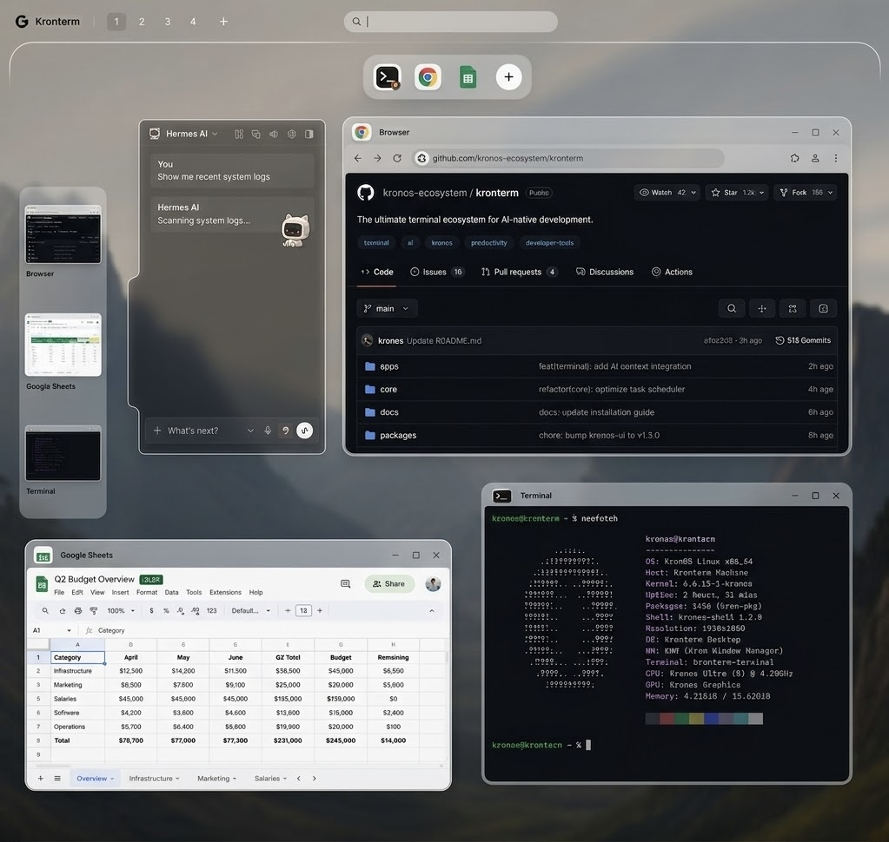

# Image Reference Rules for Coding Agents

The JPEG files under `docs/os-mode/references/` are part of the implementation specification, not decorative documentation.

## Required behavior

For every phase:

1. Render/read the inline Markdown image if your environment supports it.
2. If the Markdown renderer does not expose pixels to the model, explicitly open the referenced JPEG with your image/vision tool.
3. Treat the current UI rules as authority. Legacy JPEGs can inform broad content-to-chrome proportion only.
4. Use the prose under the image as a fallback and as engineering interpretation, not as a replacement for visual inspection.
5. After implementation, take a screenshot of Kronterm in the relevant state and compare it side-by-side with the original reference.
6. Iterate on proportions, spacing, radius, border, shadow, hierarchy, and direct motion until the implementation matches the flat System UI contract.

## Do not base64-inline images

Do not convert these references into giant base64 data URIs inside Markdown. That makes prompts larger, reduces compatibility, and often prevents coding agents from actually reasoning about the pixels. Keeping the image as a normal file plus an inline Markdown reference is the most portable structure.

## Relative paths

Phase files live in `docs/os-mode/`, so their image syntax is:

```md

```

Root-level README files use:

```md

```

## Visual truth hierarchy

1. Original reference JPEG
2. Running Kronterm screenshot
3. Phase-specific visual notes
4. General UI rules

If a prose detail conflicts with the visible reference, stop and reconcile the discrepancy rather than silently guessing.
