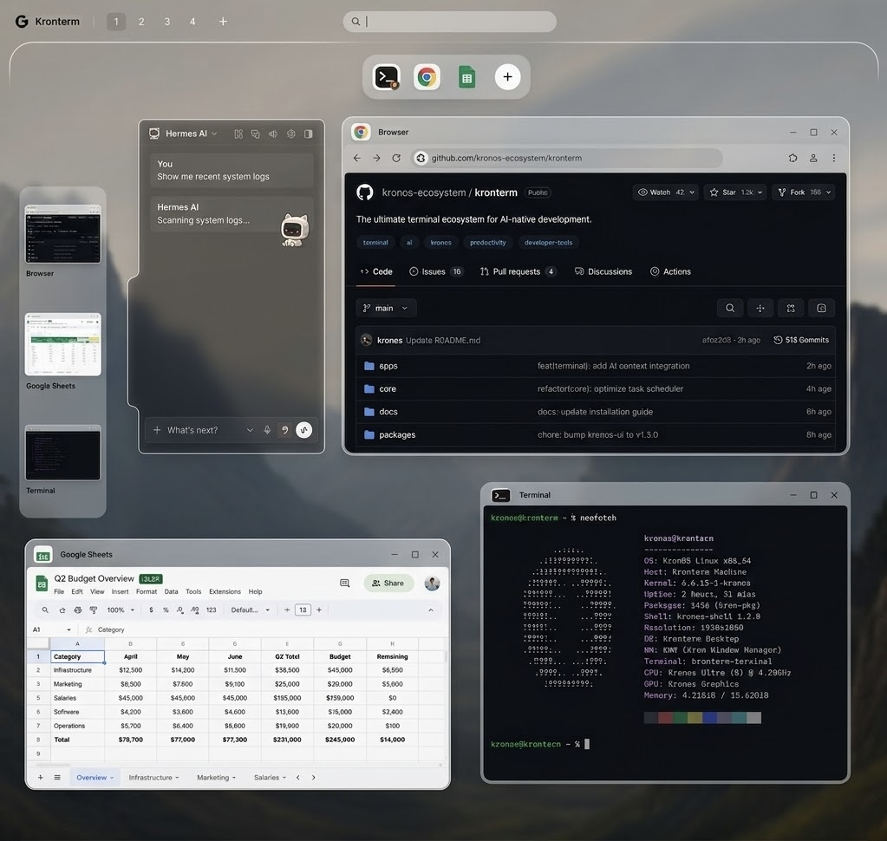
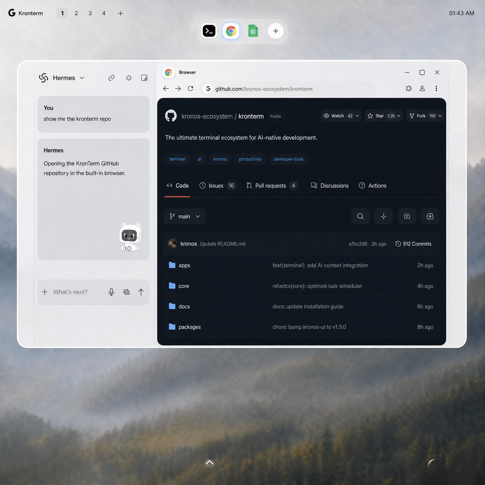
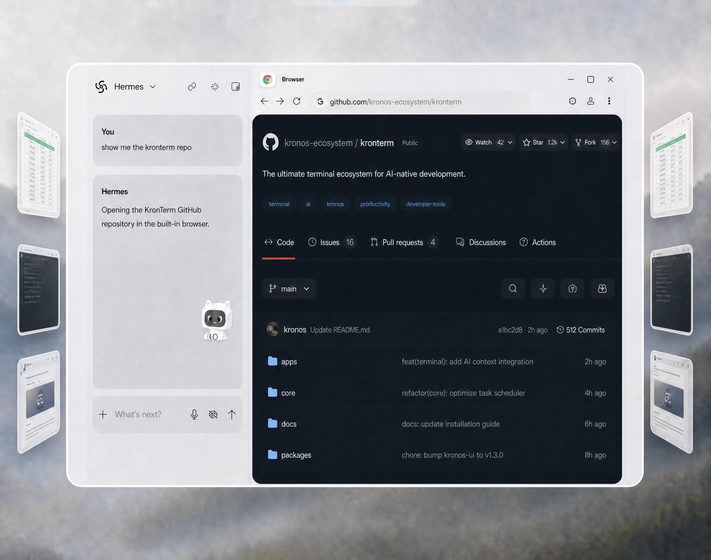
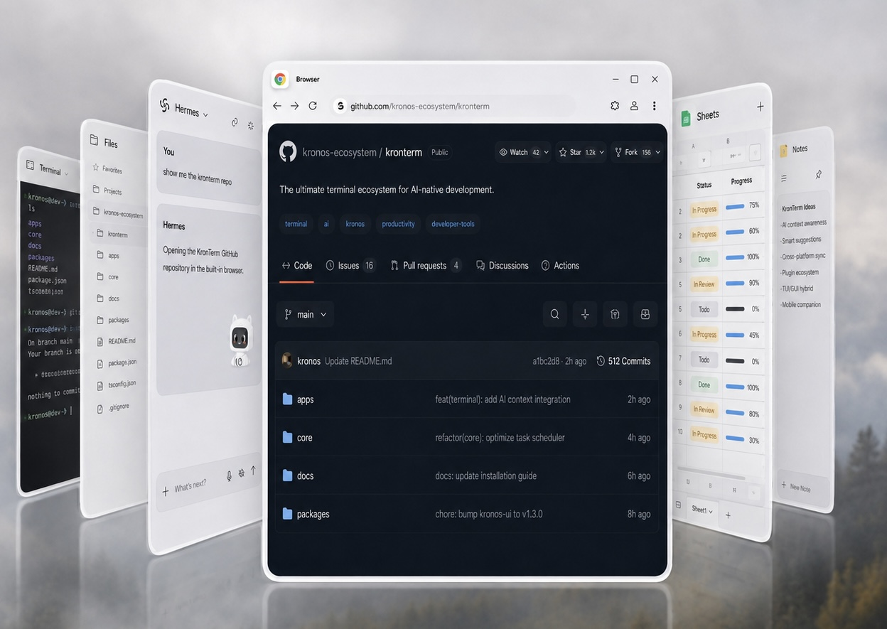

# Phase 00 — Archived Architecture + Motion Research

> Historical record only. Do not implement the perspective or Cover Flow experiments below. The current direction is defined by `CORE_CONTEXT.md`, `UI_RULES.md`, and `MOTION_SPEC.md`.

## Visual destination storyboard

Before proposing architecture, visually inspect these destination states. They are not separate pages; they are presentation states of the same persistent live sessions.









> [!IMPORTANT]
> Open the original image files with image/vision tooling before finalizing architecture or motion decisions. The target architecture must be capable of transitioning continuously between all four states without destroying the underlying Browser, Terminal, Hermes, Sheets, Files, or Notes sessions.


## Prompt

```text
We are implementing Kronterm OS Mode.

Repository:
Ahmedalsadi-1/kronterm

Required branch:
feat/kronsettings-from-kronoschamber

DO NOT IMPLEMENT THE FINAL UI IN THIS PHASE.

First read:
- docs/os-mode/CORE_CONTEXT.md
- docs/os-mode/UI_RULES.md
- docs/os-mode/MOTION_SPEC.md
- docs/os-mode/ACCEPTANCE_CRITERIA.md
- .agents/skills/kronterm-os/SKILL.md
- the existing wave-surface skill if present

AUDIT THE REAL REPOSITORY.

Locate and trace:
- Infinite Canvas
- camera/pan/zoom
- widgets/blocks
- Browser
- Terminal
- Hermes/Kronos chat/session
- Tabs Mode
- Widget Mode
- Canvas Mode
- workspace switching
- persistence
- drag/drop
- resizing
- focus and z-order
- settings/mode selection
- command routing
- shortcuts
- app/session lifecycle

Determine the correct canonical identity for a live application. Do not invent a parallel runtime if one already exists.

Research current operating-system interaction behavior only. Study:
- focus motion
- overview motion
- flat overview and direct window switching
- AI/app grouping
- observable agent activity
- human takeover behavior

Do not copy branding, proprietary artwork, private code, or proprietary assets.

Update docs/os-mode/MOTION_SPEC.md with concrete observations and tuned initial targets.

Propose a shared SpatialEngine boundary extracted from or layered over Kronterm's existing Infinite Canvas.

Return:
1. real files/components/stores involved
2. state ownership graph
3. reusable canvas pieces
4. extraction/refactor needs
5. session identity model
6. OS scene state machine
7. motion findings
8. performance risks
9. exact implementation sequence
10. regression risks

Do not move to Phase 01 until this audit is complete.
```
