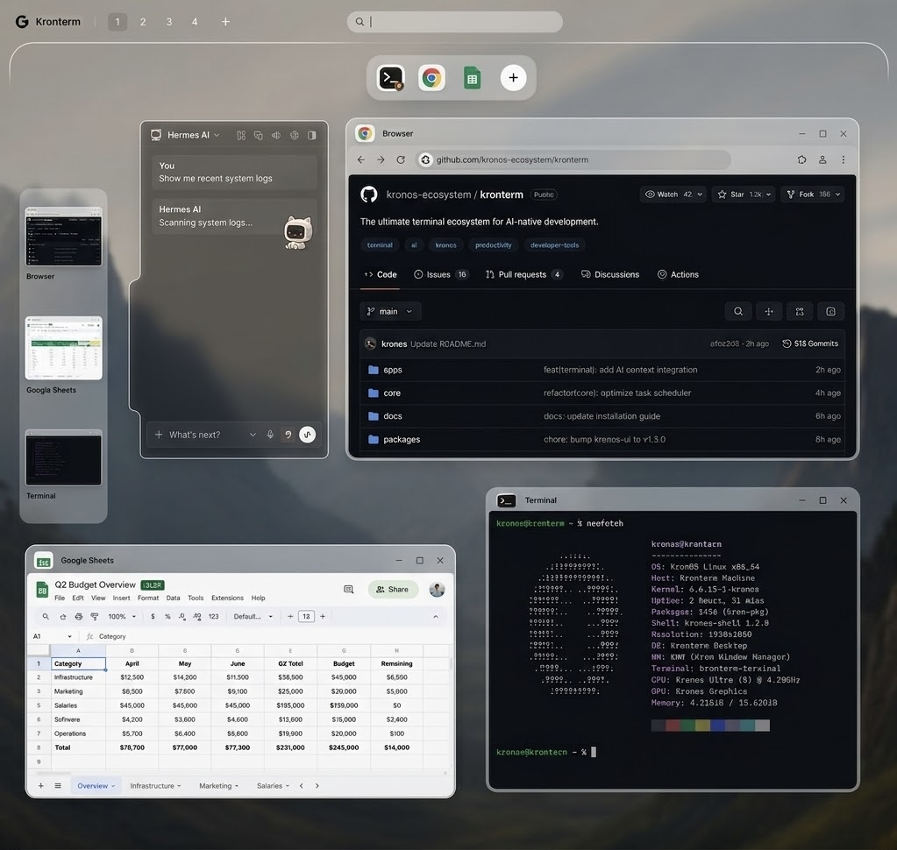

# Phase 01 — Spatial Desktop Baseline



> [!IMPORTANT]
> **MANDATORY VISION STEP:** Before editing code, open and visually inspect `docs/os-mode/references/01-spatial-desktop-baseline.jpeg` with whatever image/vision capability is available. The image is the source of truth for composition, proportions, depth, spacing, and hierarchy. Do not rely only on the prose description below.

### What the reference image is communicating
- Freeform OS desktop with Hermes upper-left, Browser upper-right, Sheets lower-left, Terminal lower-right.
- A compact vertical app preview rail sits on the far left.
- The OS shell is fixed in screen space while applications occupy the spatial world.
- The composition uses a blurred mountain wallpaper, translucent light chrome, thin white borders, large rounded corners, and quiet shadows.
- Windows are independently positioned and sized; none of the four primary app sessions should be fake screenshots.

### Image-driven acceptance rule
The phase is not complete just because the behavior exists. Capture the running Kronterm UI and compare it against this reference. Iterate until the spatial hierarchy, relative sizing, spacing, framing, and motion intent clearly match the reference while using Kronterm's real components.


## Prompt

```text
Implement Phase 01 of Kronterm OS Mode.

REFERENCE:
docs/os-mode/references/01-spatial-desktop-baseline.jpeg

GOAL:
Build the first real spatial desktop scene using live Kronterm applications.

Required composition from the reference:
- Hermes upper-left
- Browser upper-center/right
- Sheets-like app lower-left
- Terminal lower-right
- compact vertical mini app rail on the left
- fixed top OS chrome
- centered floating app dock
- atmospheric blurred wallpaper

ARCHITECTURE:
Reuse existing live Browser, Terminal, Hermes and widget/app implementations.
Do not create screenshot/fake versions of those apps.

Build:
- OS/Spatial Mode entry in the existing mode system
- screen-space shell
- world-space application windows
- drag
- resize
- focus
- z-order
- persistent bounds
- workspace-specific layouts

OS shell remains fixed while world/camera moves.

The desktop must immediately feel like an operating environment, not a canvas demo.

VISUAL TARGET:
- translucent white glass
- subtle white border
- large corner radius
- quiet shadow
- minimal chrome
- restrained active glow
- strong negative space

Overview is a flat responsive grid. Keep window rotation at zero and preserve live mounts.
Do not implement final Hermes docking yet.
Do not jump to future phases.

TEST:
- Browser remains live while moved/resized
- Terminal remains live while moved/resized
- Hermes state remains live
- focus changes z-order
- relaunch restores layout
- workspace 1/2 preserve separate layouts
- existing modes still work
```
