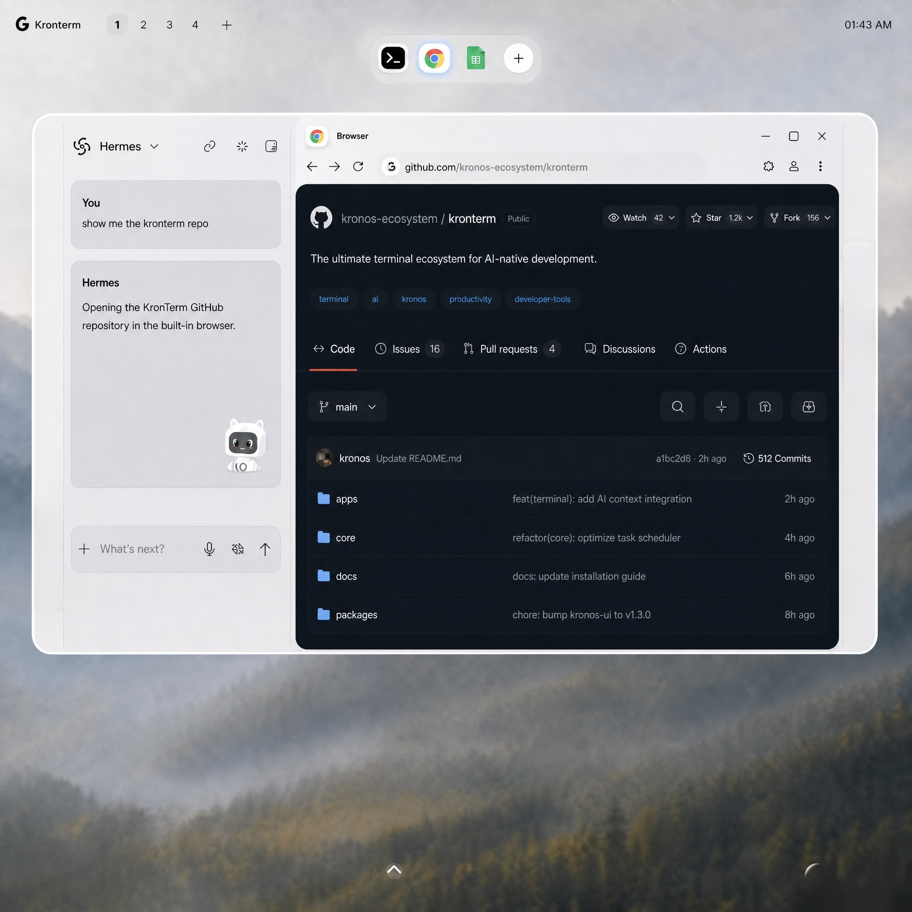

# Phase 02 — Browser + Hermes Docking



> [!IMPORTANT]
> **MANDATORY VISION STEP:** Before editing code, open and visually inspect `docs/os-mode/references/02-browser-hermes-docked.jpeg` with whatever image/vision capability is available. The image is the source of truth for composition, proportions, depth, spacing, and hierarchy. Do not rely only on the prose description below.

### What the reference image is communicating
- Hermes is docked as a wide left side panel and Browser is the dominant right work surface.
- The two surfaces read as one grouped workspace with a single outer glass frame.
- Browser remains visually primary while Hermes is clearly interactive and persistent.
- The top app dock and global OS chrome remain outside the grouped window surface.
- Docking must feel like a physical merge/resize, not a route change or remount.

### Image-driven acceptance rule
The phase is not complete just because the behavior exists. Capture the running Kronterm UI and compare it against this reference. Iterate until the spatial hierarchy, relative sizing, spacing, framing, and motion intent clearly match the reference while using Kronterm's real components.


## Prompt

```text
Implement Phase 02: Browser + Hermes grouped work surface.

REFERENCE:
docs/os-mode/references/02-browser-hermes-docked.jpeg

This state is one of the core signatures of OS Mode.

Hermes is a first-class live AppSession, not a special static sidebar.

Implement:
- standalone Hermes session
- drag Hermes toward focused Browser
- left docking target
- right docking target
- animated docking preview
- drop creates a generic WindowGroup
- Browser makes room spatially
- resizable divider
- detach restores standalone Hermes window
- Hermes conversation/session remains exactly the same

Recommended data shape:

WindowGroup {
  id
  primarySessionId
  leftPanelSessionId?
  rightPanelSessionId?
}

Do not hardcode grouping to Browser only.

MOTION:
- docking preview should appear before drop
- Hermes springs into position
- Browser shifts/resizes continuously
- no full component remount
- no page-like crossfade

VISUAL:
Match the reference's calm framed surface, soft white shell and large Browser area.

Input safety:
Dragging content inside Browser, selecting text, scrolling, or interacting with embedded content must not unintentionally drag the OS window.

Tests:
- dock left
- dock right
- resize
- detach
- re-dock
- Hermes session identity preserved
- Browser session identity preserved
```
