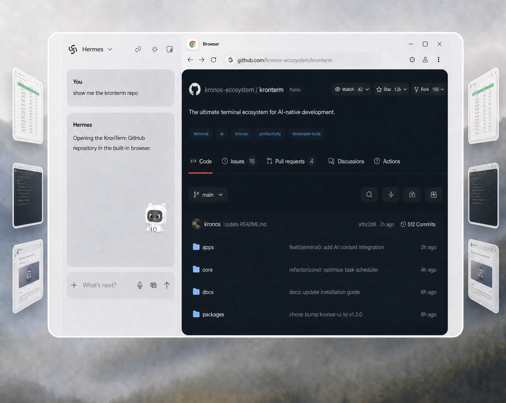

# Phase 03 — Framed Workspace



> [!IMPORTANT]
> **MANDATORY VISION STEP:** Before editing code, open and visually inspect `docs/os-mode/references/03-framed-workspace.jpeg` with whatever image/vision capability is available. The image is the source of truth for composition, proportions, depth, spacing, and hierarchy. Do not rely only on the prose description below.

### What the reference image is communicating
- The Browser + Hermes group is centered inside a larger framed spatial stage.
- Peripheral live-app presence is visible near the left/right edges rather than hidden.
- The central group is largest, brightest, least rotated, and visually closest to the camera.
- Peripheral windows should remain secondary but recognizable and selectable.
- This state establishes the transition language between focused work and deeper spatial navigation.

### Image-driven acceptance rule
The phase is not complete just because the behavior exists. Capture the running Kronterm UI and compare it against this reference. Iterate until the spatial hierarchy, relative sizing, spacing, framing, and motion intent clearly match the reference while using Kronterm's real components.


## Prompt

```text
Implement Phase 03: Framed center-stage workspace.

REFERENCE:
docs/os-mode/references/03-framed-workspace.jpeg

The Browser + Hermes group remains primary, but OS Mode should begin showing peripheral awareness of other live applications.

Build:
- large centered framed work surface
- grouped Hermes + Browser inside it
- peripheral live app presence near left/right edges
- clicking peripheral app begins focus promotion behavior

The framed group must feel architectural and OS-like, not like a card placed on a dashboard.

Use significant negative space around it.

Do not add peripheral carousels or depth transforms. Phase 08 owns responsive shell overflow, and Phase 09 owns the flat overview grid.

Ensure:
- same Browser session
- same Hermes session
- peripheral sessions remain live
- shell remains stable
```
