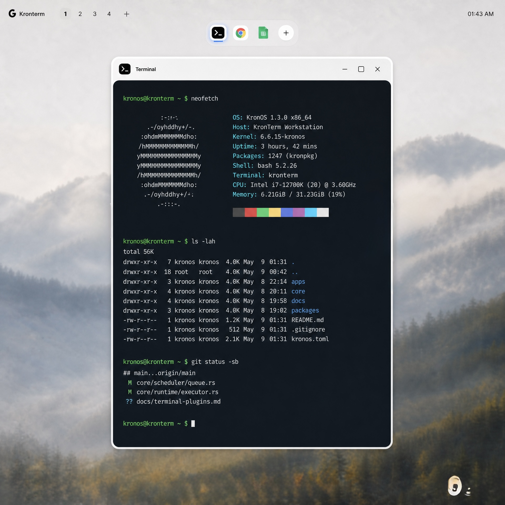

# Phase 05 — Terminal Focus



> [!IMPORTANT]
> **MANDATORY VISION STEP:** Before editing code, open and visually inspect `docs/os-mode/references/05-terminal-focused.jpeg` with whatever image/vision capability is available. The image is the source of truth for composition, proportions, depth, spacing, and hierarchy. Do not rely only on the prose description below.

### What the reference image is communicating
- Terminal is centered alone as the dominant focused application.
- The terminal uses a tall portrait-like preferred geometry rather than being forced into Browser proportions.
- Other apps are not destroyed; they are merely de-emphasized/collapsed elsewhere in the spatial system.
- The terminal shell/process must remain the same session before and after focus transitions.

### Image-driven acceptance rule
The phase is not complete just because the behavior exists. Capture the running Kronterm UI and compare it against this reference. Iterate until the spatial hierarchy, relative sizing, spacing, framing, and motion intent clearly match the reference while using Kronterm's real components.


## Prompt

```text
Implement Phase 05: Generic focused-app support using Terminal.

REFERENCE:
docs/os-mode/references/05-terminal-focused.jpeg

Terminal must become the dominant centered application with its own preferred geometry.

Requirements:
- existing live terminal session moves into focus
- no new shell/process is created merely because it focused
- other running apps recede/collapse to peripheral presentation
- Terminal state survives switching away and back

Test by running a long-lived process, focusing another app, then returning to Terminal.

MOTION:
Terminal should expand from its real previous spatial location into the center stage.
The outgoing focused window should visibly recede toward its next presentation.

Do not fake continuity with a duplicated Terminal component.
```
