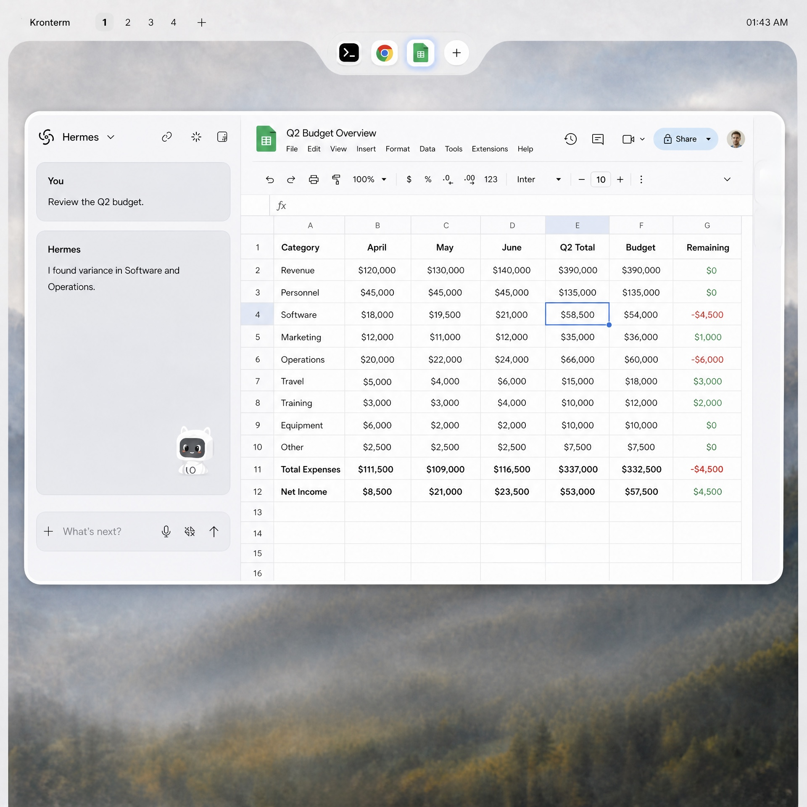

# Phase 06 — Sheets + Hermes



> [!IMPORTANT]
> **MANDATORY VISION STEP:** Before editing code, open and visually inspect `docs/os-mode/references/06-sheets-hermes-docked.jpeg` with whatever image/vision capability is available. The image is the source of truth for composition, proportions, depth, spacing, and hierarchy. Do not rely only on the prose description below.

### What the reference image is communicating
- Hermes is docked on the left and the Sheets-style application occupies the larger right surface.
- This proves docking/grouping is generic and not hardcoded to Browser.
- The combined surface remains inside the same calm glass OS language.
- Resizing and detach/re-dock must preserve both app sessions.

### Image-driven acceptance rule
The phase is not complete just because the behavior exists. Capture the running Kronterm UI and compare it against this reference. Iterate until the spatial hierarchy, relative sizing, spacing, framing, and motion intent clearly match the reference while using Kronterm's real components.


## Prompt

```text
Implement Phase 06: Generic grouped application + Hermes behavior.

REFERENCE:
docs/os-mode/references/06-sheets-hermes-docked.jpeg

Use the existing generic WindowGroup architecture from Phase 02.

Focus the existing Sheets-like/application session and dock the SAME Hermes session beside it.

Requirements:
- no Browser-specific docking code
- Hermes can dock left or right
- divider is resizable
- Hermes detaches back to standalone
- all sessions remain live
- other applications transition to peripheral presentation

This phase proves that Hermes is a universal contextual AI companion for compatible apps, not a Browser-only sidebar.
```
