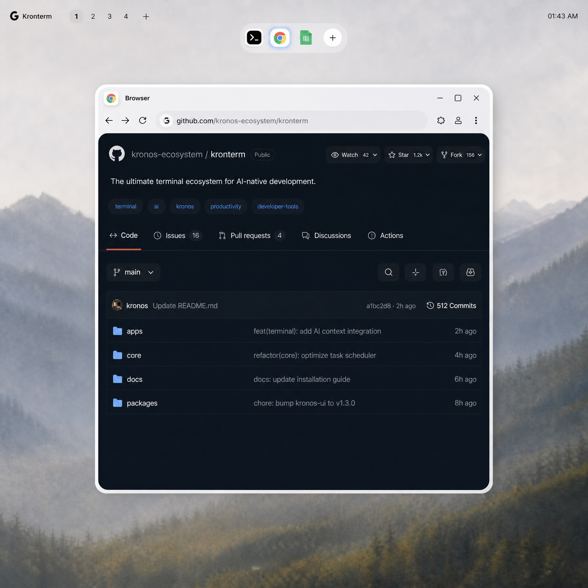

# Phase 07 — Solo Browser Focus



> [!IMPORTANT]
> **MANDATORY VISION STEP:** Before editing code, open and visually inspect `docs/os-mode/references/07-browser-solo-focused.jpeg` with whatever image/vision capability is available. The image is the source of truth for composition, proportions, depth, spacing, and hierarchy. Do not rely only on the prose description below.

### What the reference image is communicating
- Browser is centered alone as the focused app with no Hermes panel occupying the side.
- The Browser expands/recenters smoothly when Hermes collapses or detaches.
- Peripheral app access remains available through small side markers/rails.
- The scene is a distraction-reduced focus mode, not a new Browser instance.

### Image-driven acceptance rule
The phase is not complete just because the behavior exists. Capture the running Kronterm UI and compare it against this reference. Iterate until the spatial hierarchy, relative sizing, spacing, framing, and motion intent clearly match the reference while using Kronterm's real components.


## Prompt

```text
Implement Phase 07: Solo focused application state.

REFERENCE:
docs/os-mode/references/07-browser-solo-focused.jpeg

Starting from Browser + Hermes grouped state:
- collapse/detach Hermes from the focused composition
- Browser smoothly expands/recenters
- Browser remains the exact same live session
- peripheral app affordances remain available

Reverse transition must also work:
solo Browser -> Browser + Hermes

MOTION:
The Browser should reclaim space continuously as Hermes leaves.
No layout pop.
No Browser reload.
No hidden remount.

This should feel like a distraction-reduced OS focus mode.
```
