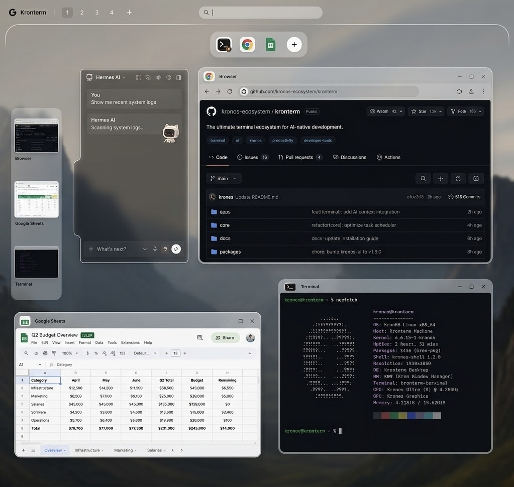
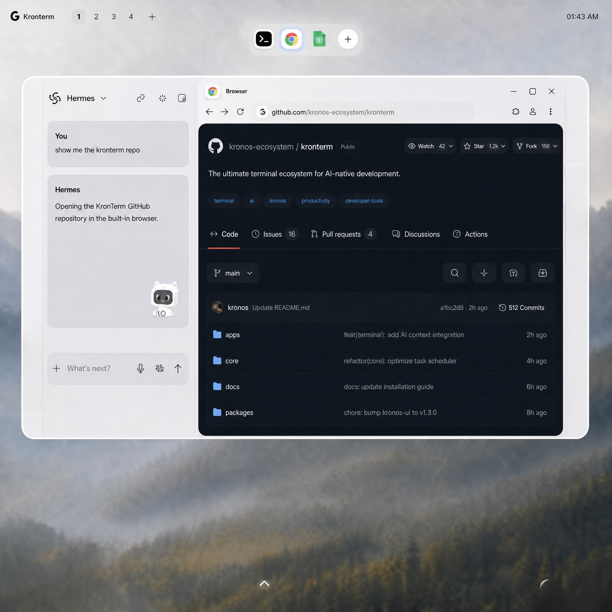
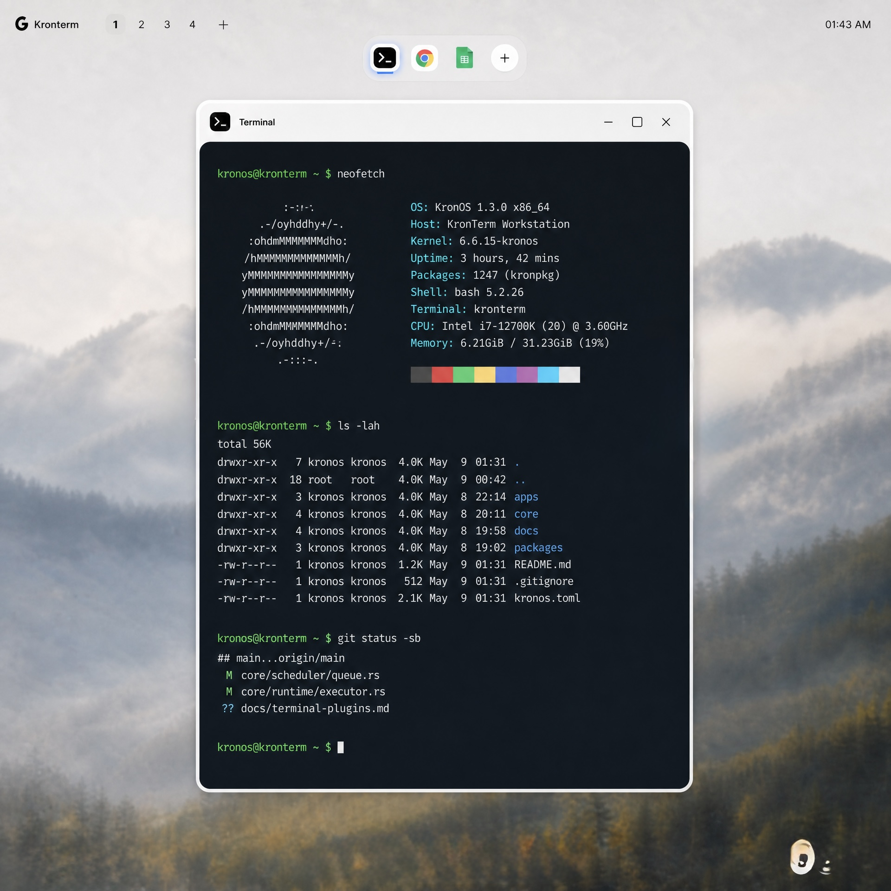
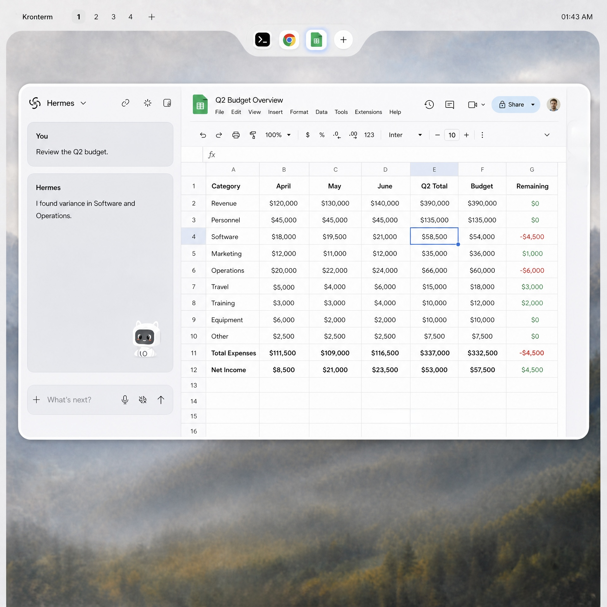
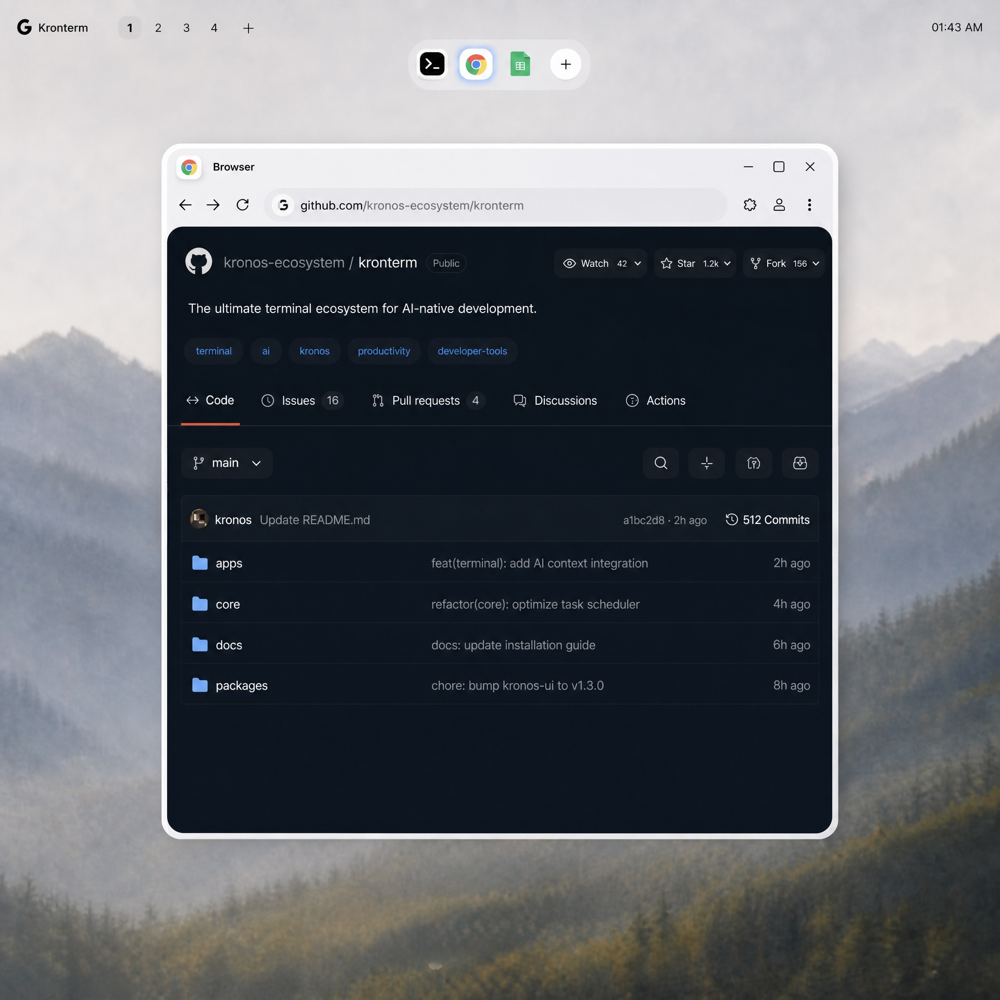

# Phase 10 — Agent Control + Regression

## Prompt

```text
Implement the final OS Mode control layer and regression pass.

The language model must NOT directly mutate arbitrary DOM/layout state.
Expose typed spatial actions.

Suggested actions:
- spatial.open
- spatial.focus
- spatial.move
- spatial.resize
- spatial.dock
- spatial.detach
- spatial.collapse
- spatial.restore
- spatial.showOverview
- spatial.switchWorkspace

Example:
{
  type: 'spatial.dock',
  sourceSessionId: 'hermes-1',
  targetSessionId: 'browser-1',
  side: 'left'
}

Natural-language scenarios:
- "Open GitHub and put the terminal beside it."
- "Show all my tabs."
- "Put yourself beside the browser."
- "Focus the terminal."
- "Move this to workspace 2."

OBSERVABLE AGENT ACTIVITY:
Show safe user-facing actions/results only, for example:
- Opening Browser
- Inspecting repository
- Editing file
- Running tests
- Waiting for login
- Task complete

Do not display hidden chain-of-thought.

Human input must remain available while the agent works.

FINAL REGRESSION:
Run the full checklist in docs/os-mode/ACCEPTANCE_CRITERIA.md.
Run tests/typecheck/build.
Perform visual QA against every image under docs/os-mode/references at multiple viewport sizes.
Fix regressions before declaring OS Mode complete.
```


## Regression visual storyboard

The final system must preserve all of these states using the same live-session model:











Validate the responsive shell and flat overview defined by Phases 08 and 09. The historical rail and Cover Flow images are retired.

> Final QA must open these actual image files and compare screenshots of the implementation against them.
