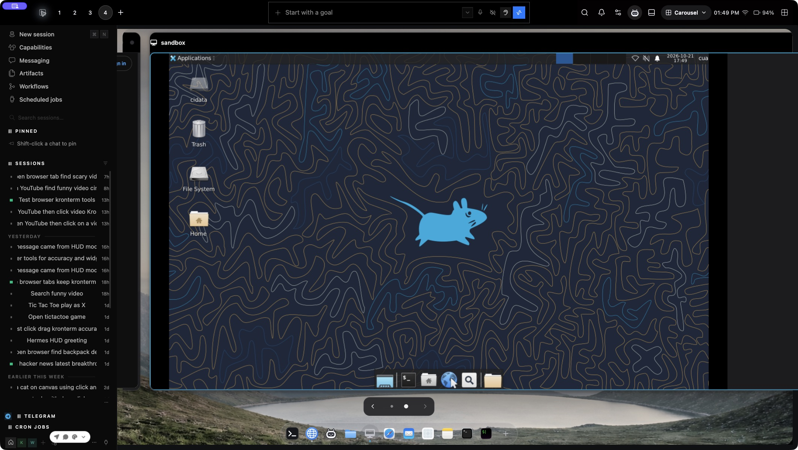
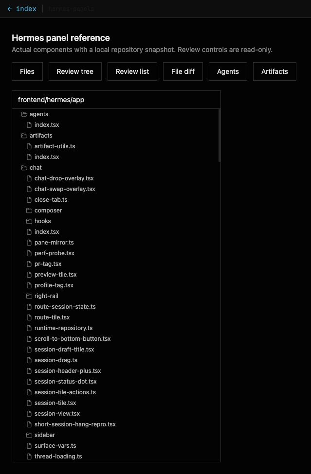
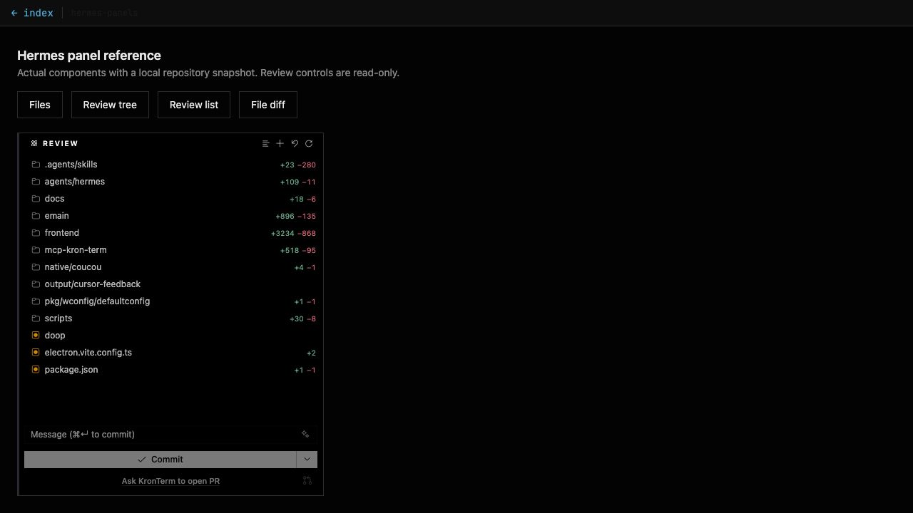
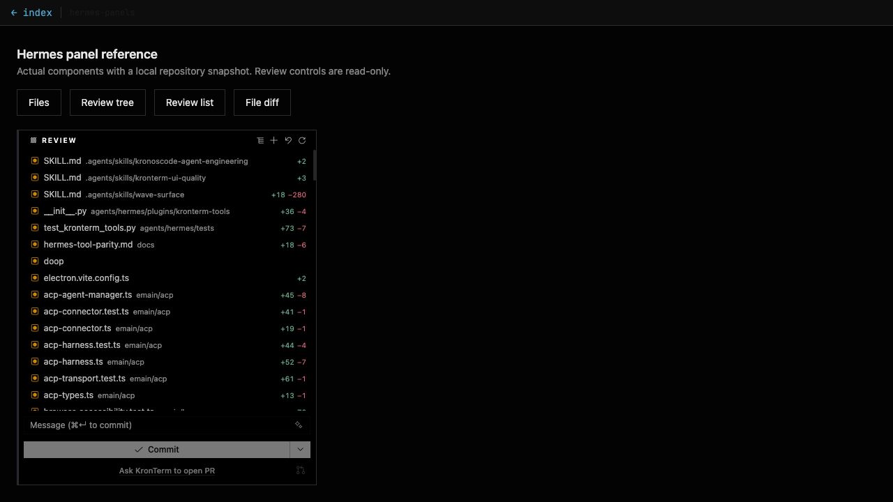
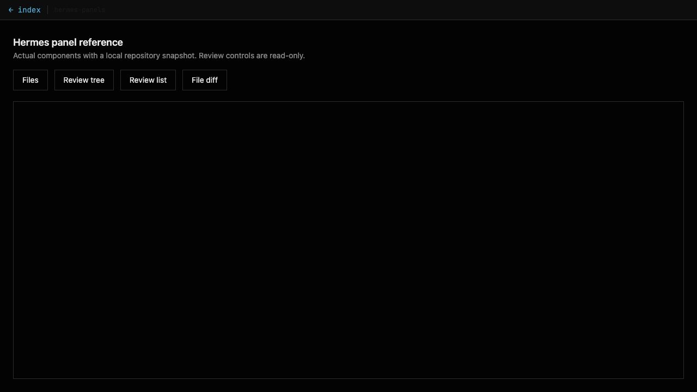
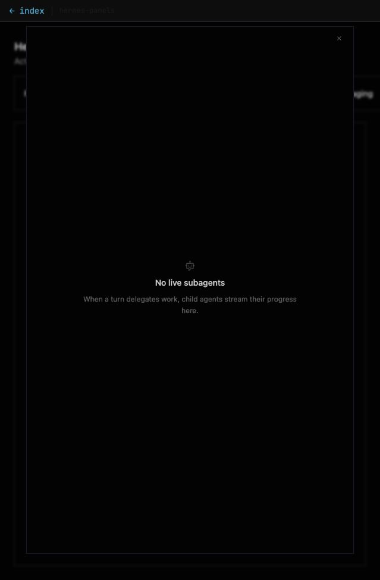
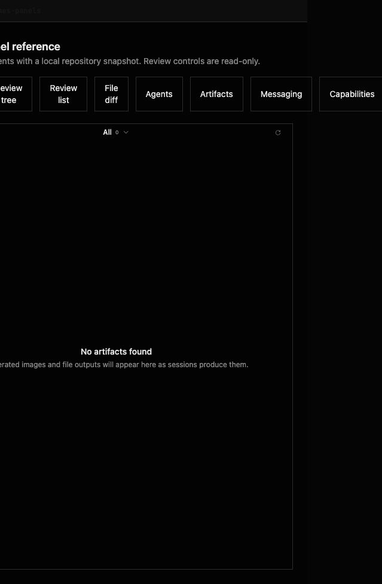
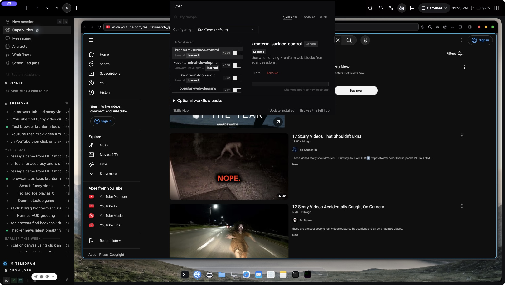

# Hermes panel reference

Captured October 21, 2026. The left rail and Capabilities images are from the running KronTerm app. Files, Review, and diff images render the actual Hermes components with a read-only snapshot of this repository. Agent monitor and Artifacts show their empty states in the component preview.

| Panel | Reference | Notes |
| --- | --- | --- |
| Navigation / sessions | [Left rail](02-left-sidebar.png) | Now controlled from the button before workspace 1. |
| File explorer | [Files](03-files.png) | Actual Hermes project tree; repository snapshot. |
| Review / diff tree | [Review tree](04-review-tree.png) | Changed files grouped by folder; stage, revert, and commit controls visible. |
| Review / flat change list | [Review list](05-review-list.png) | Alternate presentation of the same changed files. |
| File diff viewer | [File diff](06-file-diff.png) | Actual line-numbered diff renderer. |
| Agent monitor | [Agents](07-agents.png) | Empty state; delegated tasks appear here when running. |
| Artifacts | [Artifacts](08-artifacts.png) | Empty state; generated files and images appear here. |
| Capabilities | [Capabilities](10-capabilities.png) | Connected app; installed skills and capability controls. |
| Terminal | Not captured | The embedded app routes terminal actions to KronTerm terminal widgets; the internal Hermes PTY pane is suppressed. |
| Logs | Not captured | On-demand internal pane, summoned through the command palette. |
| File / URL / artifact previews | Not captured | Dynamic panes opened by selecting content; the file diff screenshot shows one related renderer. |
| KronTerm surfaces | Not captured | Plugin pane listing live terminal, browser, canvas, and sandbox blocks. |

Other full-page or overlay views include Messaging, Workflows, Scheduled jobs, Command Center, Profiles, Settings, Webhooks, and Starmap. Kanban is an optional plugin, disabled by default. These are distinct from the dockable panels above.

## Left navigation

## Files

## Review tree

## Review list

## File diff

## Agent monitor

## Artifacts

## Capabilities

